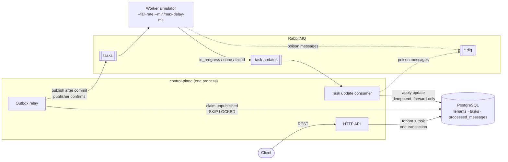
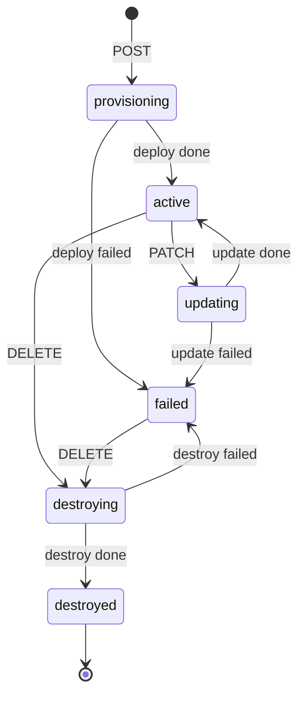
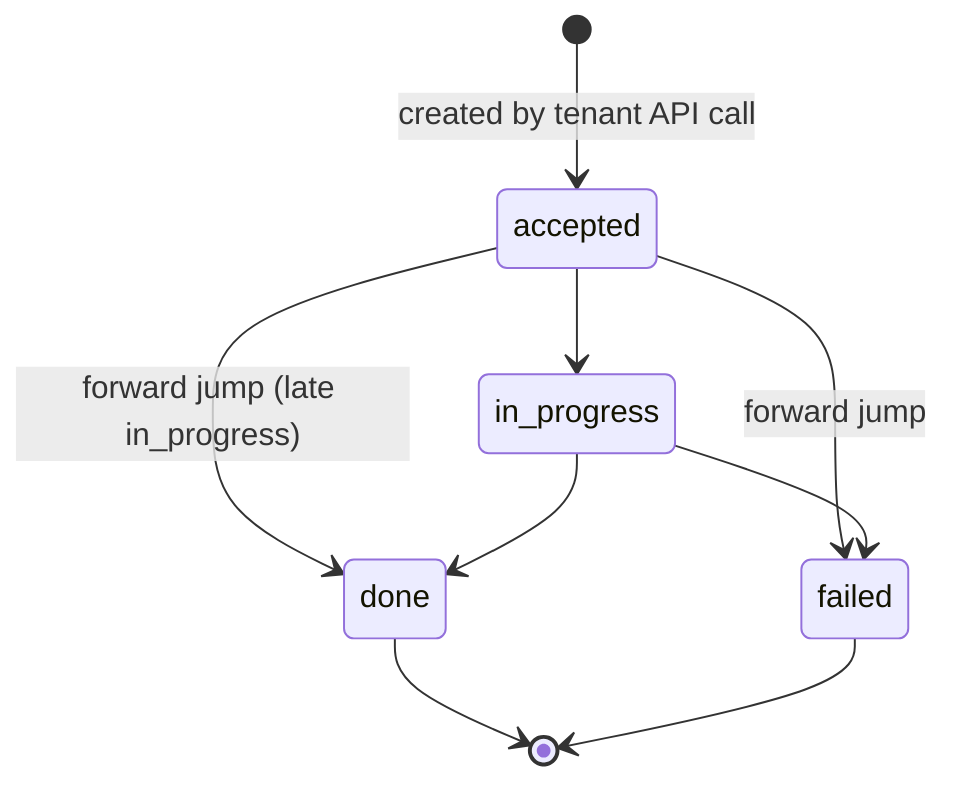
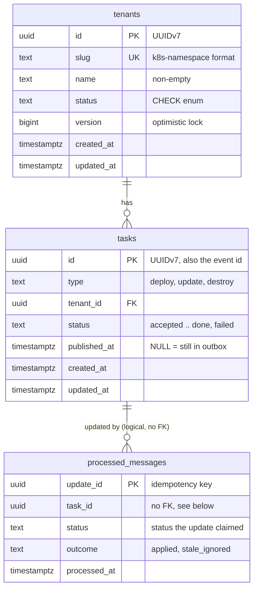

# Tenant Provisioning Control Plane

A control-plane service for a multi-tenant SaaS platform. It records tenants,
emits provisioning tasks to a message broker **after** the database commit
(transactional outbox), and consumes worker progress updates idempotently and
order-tolerantly. A worker simulator drives tasks through their lifecycle.

---


## Contents

- [Quick start](#quick-start)
- [Tech stack](#tech-stack)
- [Architecture](#architecture)
- [State machines](#state-machines)
- [REST API](#rest-api)
- [Messaging](#messaging)
- [Database schema](#database-schema)
- [Design decisions and trade-offs](#design-decisions-and-trade-offs)
- [Project layout](#project-layout)

---


## Quick start

**Prerequisite:** Docker with Compose v2. Go only for the optional E2E suite is needed on the host.

```bash
git clone <repo-url> && cd <repo>/control-plane
docker compose up --build                             # boot: Postgres, RabbitMQ, control-plane, worker
docker compose --profile test run --rm --build test   # full suite: format check, lint, security scan, tests
```


| Service     | URL                                                                                      |
| ----------- | ---------------------------------------------------------------------------------------- |
| API         | [http://localhost:8080](http://localhost:8080)                                           |
| RabbitMQ UI | [http://localhost:15672](http://localhost:15672) (default credentials in `.env.example`) |


Credentials in `.env.example` are local-development defaults, not secrets.

---


## Tech stack


| Concern             | Choice                                                    | Why                                                                                 |
| ------------------- | --------------------------------------------------------- | ----------------------------------------------------------------------------------- |
| Language            | Go 1.25                                                   | Static binary, small distroless image, first-class concurrency                      |
| HTTP routing        | `net/http` `ServeMux` (Go 1.22+ patterns)                 | Method + wildcard routing with zero dependencies                                    |
| Database            | PostgreSQL 17                                             | Transactions, `UNIQUE`/`CHECK` constraints, `FOR UPDATE SKIP LOCKED`                |
| DB driver           | `jackc/pgx/v5` + `pgxpool`                                | Fast, idiomatic, exposes SQLSTATE codes (e.g. `23505` for unique violations)        |                               |
| Broker              | RabbitMQ 4.x (management image)                           | Work-queue semantics, per-message ack/nack, native dead-lettering                   |
| AMQP client         | `rabbitmq/amqp091-go`                                     | Official client; publisher confirms                                                 |
| IDs                 | `google/uuid` (UUIDv7)                                    | App-generated (task ID exists before commit), time-ordered (index-friendly, cursor) |
| Logging             | `log/slog` (JSON)                                         | Standard library, structured                                                        |
| Lint / format / sec | `golangci-lint` (incl. `gofumpt`, `gosec`), `govulncheck` | One command for static analysis, formatting and security                            |
| Tests               | `go test -race`                                           | Unit tests + integration tests against real Postgres and RabbitMQ                   |
| Packaging           | Multi-stage Dockerfile, Docker Compose                    | One image, two entrypoints (`control-plane`, `worker`)                              |


---


## Architecture




Four containers: `postgres`, `rabbitmq`, `control-plane`, `worker`. The
control-plane and worker are two entrypoints of **one image**. Inside the
control-plane process, three components run as goroutines sharing one DB pool:


| Component            | Responsibility                                                        |
| ---------------------| --------------------------------------------------------------------- |
| HTTP API             | Validates requests, writes tenant + task in one transaction           |
| Outbox relay         | Publishes committed, unpublished tasks to RabbitMQ in creation order  |
| Task update consumer | Applies worker updates to tasks (and to tenants on terminal outcomes) |


### High-level workflow

```mermaid
sequenceDiagram
    autonumber
    actor C as Client
    participant API as HTTP API
    participant DB as PostgreSQL
    participant R as Outbox relay
    box RabbitMQ
        participant QT as tasks queue
        participant QU as task-updates queue
    end
    participant W as Worker simulator
    participant TU as Task update consumer

    C->>API: POST /v1/tenants {slug, name}
    API->>DB: BEGIN<br/>INSERT tenant (provisioning)<br/>INSERT task (deploy, accepted, published_at NULL)<br/>COMMIT
    API--)R: nudge (non-blocking, after commit)
    API-->>C: 202 {tenant, task}

    R->>DB: BEGIN; SELECT unpublished tasks ORDER BY id<br/>LIMIT 100 FOR UPDATE SKIP LOCKED
    R->>QT: publish each task (await broker confirm)
    R->>DB: UPDATE published_at = now() (confirmed only); COMMIT

    QT->>W: deliver task
    W--)QU: publish {update_id, task_id, in_progress}
    Note over W: simulated work<br/>(random delay, fail-rate)
    W--)QU: publish {update_id, task_id, done | failed}
    W->>QT: ack task
    Note over QU: updates wait here until consumed.<br/>The worker never touches the DB.

    loop each update, independently of the worker
        QU->>TU: deliver update
        TU->>DB: one transaction:<br/>lock task FOR UPDATE<br/>skip if update_id already seen (duplicate)<br/>forward-only status change, else stale_ignored<br/>if terminal: tenant status + version+1<br/>record update_id
        TU->>QU: ack (only after commit)
    end

    C->>API: GET /v1/tenants/{id}
    API-->>C: 200 {status: "active", version: 2}
```


---


## State machines

The authoritative tables live in `[internal/domain/transitions.go](internal/domain/transitions.go)`
and are tested exhaustively (every status × every operation).

### Tenant




### Task




### Allowed operations by tenant status


| Tenant status  | PATCH                           | DELETE                          |
| -------------- | ------------------------------- | ------------------------------- |
| `provisioning` | 409 `tenant_update_not_allowed` | 409 `tenant_update_not_allowed` |
| `active`       | → `updating` + `update` task    | → `destroying` + `destroy` task |
| `updating`     | 409                             | 409                             |
| `destroying`   | 409                             | 409                             |
| `failed`       | 409                             | → `destroying` + `destroy` task |
| `destroyed`    | 409                             | 409                             |


Because only `active`/`failed` tenants accept new work and every accepted
call moves the tenant into a busy status, **at most one open task per tenant**
falls out of the guards. A partial unique index enforces it again as defence
in depth.

---


## REST API

Base path: `/v1`. All bodies are JSON. Timestamps are ISO 8601 UTC with
milliseconds, e.g. `2026-10-12T05:30:00.123Z`.

### Endpoints


| Method   | Path               | Purpose                              | Success | Errors                                                                     |
| -------- | ------------------ | ------------------------------------ | ------- | -------------------------------------------------------------------------- |
| `POST`   | `/v1/tenants`      | Create a tenant (starts deploy)      | 202     | 400, 409 `tenant_already_exists`, 422                                      |
| `GET`    | `/v1/tenants`      | List tenants (paginated, filterable) | 200     | 422                                                                        |
| `GET`    | `/v1/tenants/{id}` | Get one tenant                       | 200     | 404 `tenant_not_found`                                                     |
| `PATCH`  | `/v1/tenants/{id}` | Partial update (starts update)       | 202     | 400, 404, 409 `tenant_update_not_allowed` / `tenant_version_conflict`, 422 |
| `DELETE` | `/v1/tenants/{id}` | Delete (starts destroy)              | 202     | 404, 409 `tenant_update_not_allowed`                                       |
| `GET`    | `/v1/tasks`        | List tasks (paginated, filterable)   | 200     | 422                                                                        |
| `GET`    | `/v1/tasks/{id}`   | Get one task                         | 200     | 404 `task_not_found`                                                       |
| `GET`    | `/healthz`         | Liveness                             | 200     |                                                                            |
| `GET`    | `/readyz`          | Readiness (DB reachable)             | 200     | 503 `not_ready`                                                            |


Tasks are **read-only** over HTTP: `POST`/`PATCH`/`DELETE` on `/v1/tasks`
return 405. They are created only as a side effect of tenant calls and driven
only by the worker.

**Why 202 Accepted for mutations:** the change is asynchronous. The response
contains the tenant's new state and the task that will carry the work out;
poll the task or tenant to follow progress.

### Create a tenant

```bash
curl -s -X POST localhost:8080/v1/tenants \
  -H 'Content-Type: application/json' \
  -d '{"slug": "acme-eu", "name": "Acme Corporation (EU)"}'
```

`202 Accepted`, `Location: /v1/tenants/{id}`

```json
{
  "tenant": {
    "id": "0192f3a1-7c2e-7b4d-9f10-3a5c8e2d1b44",
    "slug": "acme-eu",
    "name": "Acme Corporation (EU)",
    "status": "provisioning",
    "version": 1,
    "created_at": "2026-10-12T05:30:00.123Z",
    "updated_at": "2026-10-12T05:30:00.123Z"
  },
  "task": {
    "id": "0192f3a1-7c2f-7000-8000-000000000001",
    "type": "deploy",
    "tenant_id": "0192f3a1-7c2e-7b4d-9f10-3a5c8e2d1b44",
    "status": "accepted",
    "created_at": "2026-10-12T05:30:00.123Z",
    "updated_at": "2026-10-12T05:30:00.123Z"
  }
}
```

Rules: `slug` is 3–28 chars matching `^[a-z][-a-z0-9]{1,26}[a-z0-9]$`
(Kubernetes-namespace compatible) and unique forever, including against
destroyed tenants. `name` must be non-empty.

### Get a tenant

```bash
curl -s localhost:8080/v1/tenants/0192f3a1-7c2e-7b4d-9f10-3a5c8e2d1b44
```

`200 OK` with the tenant object. A malformed or unknown ID returns
`404 tenant_not_found`.

### List tenants

```bash
curl -s 'localhost:8080/v1/tenants?status=active&limit=20'
curl -s 'localhost:8080/v1/tenants?limit=20&cursor=0192f3a1-7c2e-7b4d-9f10-3a5c8e2d1b44'
```

```json
{
  "data": [ { "id": "...", "slug": "acme-eu", "status": "active", "...": "..." } ],
  "next_cursor": "0192f3a1-7c2e-7b4d-9f10-3a5c8e2d1b44"
}
```


| Query param | Meaning                              | Default |
| ----------- | ------------------------------------ | ------- |
| `status`    | Filter by tenant status              | all     |
| `limit`     | Page size, 1–100                     | 20      |
| `cursor`    | `next_cursor` from the previous page | start   |


Pagination is keyset-based on `id` (UUIDv7, so creation order). It is stable
under concurrent inserts, unlike offset pagination. `next_cursor` is `null` on
the last page.

### Update a tenant

`version` is required (optimistic locking). Only `name` is mutable; sending
`slug` returns 422.

```bash
curl -s -X PATCH localhost:8080/v1/tenants/0192f3a1-7c2e-7b4d-9f10-3a5c8e2d1b44 \
  -H 'Content-Type: application/json' \
  -d '{"version": 2, "name": "Acme EU"}'
```

`202 Accepted` with `{tenant, task}`; the tenant is now `updating`, its
`version` is incremented and the new name is stored as desired state.

If the tenant changed since you read it: `409 tenant_version_conflict` (refetch
and retry). If it's not `active`: `409 tenant_update_not_allowed` (wait).

### Delete a tenant

```bash
curl -s -X DELETE localhost:8080/v1/tenants/0192f3a1-7c2e-7b4d-9f10-3a5c8e2d1b44
```

`202 Accepted` with `{tenant, task}`; the tenant is `destroying`, and becomes
`destroyed` when the worker finishes. Allowed from `active` and `failed`.
The tenant row is kept (and stays readable) so its slug remains reserved.

### Tasks

```bash
curl -s 'localhost:8080/v1/tasks?tenant_id=0192f3a1-7c2e-7b4d-9f10-3a5c8e2d1b44'
curl -s 'localhost:8080/v1/tasks?status=failed&type=deploy&limit=50'
curl -s localhost:8080/v1/tasks/0192f3a1-7c2f-7000-8000-000000000001
```


| Query param       | Meaning                                     |
| ----------------- | ------------------------------------------- |
| `tenant_id`       | Tasks for one tenant                        |
| `status`          | `accepted`, `in_progress`, `done`, `failed` |
| `type`            | `deploy`, `update`, `destroy`               |
| `limit`, `cursor` | As for tenants                              |


### Errors

Every error, including unknown routes and wrong methods, has the same shape:

```json
{
  "error": {
    "code": "tenant_version_conflict",
    "message": "tenant version does not match; refetch and retry",
    "details": { "field": "reason, for validation errors only" }
  }
}
```


| Code                        | HTTP | When                                                             |
| --------------------------- | ---- | ---------------------------------------------------------------- |
| `tenant_not_found`          | 404  | Unknown or malformed tenant ID                                   |
| `task_not_found`            | 404  | Unknown or malformed task ID                                     |
| `tenant_already_exists`     | 409  | Slug taken (including by a destroyed tenant)                     |
| `tenant_update_not_allowed` | 409  | PATCH or DELETE not allowed in the tenant's current status       |
| `tenant_version_conflict`   | 409  | PATCH `version` doesn't match the current version                |
| `validation_error`          | 422  | Well-formed JSON with invalid values; `details` lists each field |
| `invalid_request`           | 400  | Malformed JSON, unknown fields, wrong types, oversized body      |
| `route_not_found`           | 404  | No such path                                                     |
| `method_not_allowed`        | 405  | Path exists, method doesn't (`Allow` header lists valid methods) |
| `not_ready`                 | 503  | Readiness check failed                                           |
| `internal_error`            | 500  | Unexpected failure; details are logged, never returned           |


The first five codes are the contract from the brief.
`tenant_update_not_allowed` covers DELETE as well as PATCH, because the
contract has no separate delete code.

**PATCH error precedence:** `tenant_not_found` → `tenant_update_not_allowed`
→ `tenant_version_conflict`. A busy tenant can't be updated even with a fresh
version, so "not allowed" is the more useful answer.

## Testing Scenarios - With scripts

### Running the E2E tests

**Prerequisites:** Docker with Compose v2, curl, and **Go** (the version in `go.mod`).
Go is only needed for the E2E suite; everything else runs in containers.

**One-time setup** (from the repo root):

```bash
chmod +x scripts/*.sh
go mod tidy                  # fetches the test dependencies (RabbitMQ client)
```

**Run:**

```bash
scripts/e2e.sh               # everything (both phases)
scripts/e2e.sh api           # phase 1 only: lifecycle + API errors (worker running)
scripts/e2e.sh broker        # phase 2 only: broker scenarios, matrices, concurrency (worker stopped)
scripts/e2e.sh Concurrency   # tests whose name matches a pattern
scripts/e2e.sh OutOfOrder    # a single test
scripts/e2e.sh --help        # usage
```

The script boots the stack if it isn't up (`docker compose up -d --build`), waits
for `/readyz`, and starts or stops the worker for each phase. You don't need to
manage containers yourself. The script already runs `go test -v`, so don't pass
`-v`; pass only a phase name or a test-name pattern.

| Option | Effect |
|---|---|
| `E2E_API_URL=http://host:port` | API to test against (default `http://localhost:8080`) |
| `KEEP_FAST_WORKER=1` | leave the fast test worker running afterwards (default: restore normal settings) |

**Reading the output.** Each test prints `=== RUN` / `--- PASS` / `--- FAIL`. A test
that needs the other phase shows `--- SKIP`, which is expected when you run a single
pattern: it is skipped in one phase and runs in the other. The script ends with
`== All selected E2E tests passed`, or exits non-zero at the first failure. A
pattern that matches no tests is an error, not a pass.

**Safe to repeat.** Tests create uniquely named tenants (e.g. `race-1760432101-3`)
and never wipe data, so you can run them against your dev stack as often as you like.

## Negative Test Scenarios 

### 1. Worker failures and delays (restart the worker with new settings)


#### Quick way: `scripts/mixed-outcomes-worker-fail-rate.sh` 

One command restarts the worker with a fail rate, creates tenants, waits for the
worker to finish them, and prints how each one ended. Needs only `curl` and the
running stack.

```bash
scripts/mixed-outcomes-worker-fail-rate.sh  [fail_rate] [count]
```


| Command                                             | What it shows            | Expected                                |
| --------------------------------------------------- | ------------------------ | --------------------------------------- |
| `scripts/mixed-outcomes-worker-fail-rate.sh 1 5`    | every task fails         | all 5 tenants `failed` (v2)             |
| `scripts/mixed-outcomes-worker-fail-rate.sh 0.3 10` | mixed outcomes (default) | roughly 7 `active` / 3 `failed`, all v2 |
| `scripts/mixed-outcomes-worker-fail-rate.sh 0 20`   | every task succeeds      | all 20 `active` (v2)                    |


Sample output:

```
summary:
      7 active
      3 failed
OK: every tenant settled
```

The script exits non-zero if any tenant is still `provisioning` after 60 s (a
stuck tenant would be a bug). When it finishes it restores the worker defaults
(fail rate 0); set `KEEP_WORKER=1` to leave your fail rate in place, for example
to try PATCH/DELETE on the failed tenants:

```bash
KEEP_WORKER=1 scripts/mixed-outcomes-worker-fail-rate.sh 1 3
```


### 2. Broker-level scenarios (publish directly to RabbitMQ)

Some failures can't be produced reliably by the worker: a stale update arriving
late, the same message delivered twice, a garbage payload. To test these, the
E2E suite stops the worker and plays it, publishing crafted messages straight to
`task-updates`, then checks the result through the API.

**Requires Go** (the version in `go.mod`). These scenarios are Go tests in `e2e/`,
run by phase 2 of `scripts/e2e.sh`, which stops the worker and always restores
it afterwards.

```bash
scripts/e2e.sh broker       # all broker-level scenarios
scripts/e2e.sh OutOfOrder   # just one, by test name
```


| Test                                          | Scenario                                    | Expected                                                          |
| --------------------------------------------- | ------------------------------------------- | ----------------------------------------------------------------- |
| `TestMessaging_OutOfOrder`                    | `done`, then a late `in_progress`           | task stays `done`; the late update is recorded as `stale_ignored` |
| `TestMessaging_DuplicateIsIdempotent`         | same `update_id` delivered 3 times          | applied once; tenant v2, not v4                                   |
| `TestMessaging_PoisonMessagesAreDeadLettered` | garbage JSON, invalid status, unknown task  | moved to `task-updates.dlq`; the consumer keeps processing        |
| `TestMessaging_FailedOutcome`                 | `failed` update                             | task `failed`, tenant `failed`                                    |
| `TestMessaging_ManyTenantsInParallel`         | 20 tenants, mixed outcomes at once          | all settle, none stuck                                            |
| `TestMatrix_TaskUpdates`                      | every task status × every update (12 cases) | only forward transitions apply                                    |


To watch the consumer's decisions while the tests run:

```bash
docker compose logs -f control-plane | grep "task update consumer"
```

To inspect what landed in the DLQ, open the RabbitMQ UI at
[http://localhost:15672](http://localhost:15672) → Queues → `task-updates.dlq` → Get messages.

### 3. Race conditions (concurrent requests)

Races can't be reproduced by hand: the requests have to reach the server within
milliseconds of each other. The E2E suite does this by releasing many goroutines
at the same instant against the real API, then checking both the HTTP responses
and the resulting state (`version`, number of tasks created).

**Requires Go.** Run from phase 2 of `scripts/e2e.sh` (worker stopped, so tenants
stay in the state the test puts them in):

```bash
scripts/e2e.sh Concurrency
```


| Test                                 | Race                                  | Expected                                                                       |
| ------------------------------------ | ------------------------------------- | ------------------------------------------------------------------------------ |
| `TestConcurrency_SameSlugCreates`    | many POSTs with the same slug         | exactly one 202; the rest 409 `tenant_already_exists`                          |
| `TestConcurrency_SameVersionPatches` | many PATCHes with the same `version`  | exactly one 202; the rest 409 `version_conflict`; only one update task created |
| `TestConcurrency_Deletes`            | many DELETEs on one tenant            | exactly one 202; the rest 409                                                  |
| `TestConcurrency_PatchVersusDelete`  | PATCH and DELETE racing on one tenant | exactly one wins; the tenant ends in the winner's state with one new task      |


How it's prevented: every state change is a single conditional `UPDATE`
(`WHERE id = $1 AND status = ANY(allowed) AND version = $n`), so only one request
can match the row; slug uniqueness is enforced by a `UNIQUE` constraint.

#### Verifying a race yourself

Each test prints the tenant it raced on (visible because `scripts/e2e.sh` runs with `-v`):

```
concurrency_test.go:70: slug=race-1760432101-3 id=0192f3a1-...: 20 concurrent PATCHes at v2 → 1×202, 19×409; now v3
```

Check the result directly in Postgres using that slug:

```bash
docker compose exec postgres psql -U controlplane -d controlplane -c "
  SELECT t.slug, t.status, t.version, k.type, k.status AS task_status
  FROM tenants t JOIN tasks k ON k.tenant_id = t.id
  WHERE t.slug = 'race-1760432101-3'
  ORDER BY k.created_at;"
```

Expected for the PATCH race: version went up by exactly one, and there are exactly
two tasks (the original `deploy` and one `update`). If both PATCHes had won, you
would see two `update` tasks and the version bumped twice.

#### Manual way: restart the worker yourself

`docker compose up -d worker` recreates only the worker with the new values; everything else keeps running.


| Scenario                                      | Command                                                                           | Then do                                                                                   | Expected                                                                                           |
| --------------------------------------------- | --------------------------------------------------------------------------------- | ----------------------------------------------------------------------------------------- | -------------------------------------------------------------------------------------------------- |
| Every task fails                              | `WORKER_FAIL_RATE=1 docker compose up -d worker`                                  | `POST /v1/tenants`                                                                        | tenant `provisioning` → `failed` (v2); deploy task `failed`                                        |
| PATCH a failed tenant                         | *(as above)*                                                                      | `PATCH /v1/tenants/<tenant_id>` `{"version":2,"name":"x"}`                                | **409** `tenant_update_not_allowed`                                                                |
| DELETE a failed tenant (worker still failing) | *(as above)*                                                                      | `DELETE /v1/tenants/<tenant_id>`                                                          | **202** `destroying`; the destroy task fails too → `failed` (v4)                                   |
| Retry the DELETE (worker healthy)             | `docker compose up -d worker`                                                     | `DELETE /v1/tenants/<tenant_id>` again                                                    | **202** `destroying` → `destroyed` (v6); task history: deploy failed, destroy failed, destroy done |
| Slow worker: see in-between states            | `WORKER_MIN_DELAY_MS=15000 WORKER_MAX_DELAY_MS=15000 docker compose up -d worker` | `POST`, then `GET` the tenant and its tasks                                               | task `in_progress`, tenant still `provisioning` for ~15 s                                          |
| Changes while busy                            | *(slow worker)*                                                                   | `PATCH` or `DELETE` during the 15 s                                                       | **409** `tenant_update_not_allowed`                                                                |
| Worker crash mid-task                         | *(slow worker)*                                                                   | `POST`, then `docker compose stop worker` within 15 s, then `docker compose start worker` | task is **redelivered** (`"redelivered":true` in the worker log) and completes; tenant `active`    |
| Back to normal                                | `docker compose up -d worker`                                                     | —                                                                                         | defaults: fail-rate 0, 500–3000 ms                                                                 |


The same settings exist as CLI flags: `--fail-rate`, `--min-delay-ms`, `--max-delay-ms`, `--concurrency`.

### 2. Outages


| Scenario           | Steps                                                                                                   | Expected                                                                                                     |
| ------------------ | ------------------------------------------------------------------------------------------------------- | ------------------------------------------------------------------------------------------------------------ |
| RabbitMQ down      | `docker compose stop rabbitmq`; create 3 tenants; `docker compose start rabbitmq`                       | creates still return **202** (tasks wait in the outbox, `published_at` NULL); after restart all 3 → `active` |
| Control plane down | `docker compose stop control-plane` while tasks are running; wait; `docker compose start control-plane` | worker updates wait in `task-updates`; on start all are applied                                              |
| Postgres down      | `docker compose stop postgres`; `curl localhost:8080/readyz`                                            | **503** `not_ready`; recovers after `docker compose start postgres`                                          |


### Automated equivalents

`scripts/e2e.sh` runs all scenarios in sections 1–2 as tests (lifecycle, transition matrices, duplicates, out-of-order, poison, concurrency) and exits non-zero on any failure.

---


## Messaging


| Queue                           | Direction              | Producer     | Consumer              |
| ------------------------------- | ---------------------- | ------------ | --------------------- |
| `tasks`                         | control-plane → worker | Outbox relay | Worker simulator      |
| `task-updates`                  | worker → control-plane | Worker       | Task update consumer  |
| `tasks.dlq`, `task-updates.dlq` | dead letters           | —            | Inspected manually    |


All queues and messages are durable/persistent.

### Task message (`tasks`)

The task *is* the event; AMQP `message_id` = task `id`.

```json
{
  "id": "0192f3a1-7c2f-7000-8000-000000000001",
  "type": "deploy",
  "tenant_id": "0192f3a1-7c2e-7b4d-9f10-3a5c8e2d1b44",
  "status": "accepted",
  "created_at": "2026-10-12T05:30:00.123Z"
}
```


### Progress update (`task-updates`)

`update_id` is the idempotency key (also AMQP `message_id`).

```json
{
  "update_id": "0192f3a2-0000-7000-8000-00000000abcd",
  "task_id": "0192f3a1-7c2f-7000-8000-000000000001",
  "status": "done",
  "occurred_at": "2026-10-12T05:30:03.456Z"
}
```


### Consumer guarantees


| Requirement    | Mechanism                                                                                                                                                                            |
| -------------- | ------------------------------------------------------------------------------------------------------------------------------------------------------------------------------------ |
| Idempotent     | `update_id` inserted into `processed_messages` in the same transaction as the state change; a redelivery hits the primary key and is acked as a no-op                                |
| Order-tolerant | Forward-only conditional UPDATE (`WHERE status = ANY(predecessors)`); a stale update matches zero rows and is recorded as `stale_ignored`                                            |
| Resilient      | Broker reconnect with exponential backoff; transient DB errors are nacked and retried; malformed messages or unknown tasks go to the DLQ and are acked so they never block the queue |


---


## Database schema




### `tenants`

```sql
CREATE TABLE tenants (
    id          uuid           PRIMARY KEY,
    slug        text           NOT NULL,
    name        text           NOT NULL,
    status      text           NOT NULL,
    version     bigint         NOT NULL DEFAULT 1,
    created_at  timestamptz(3) NOT NULL,
    updated_at  timestamptz(3) NOT NULL,

    CONSTRAINT tenants_slug_key       UNIQUE (slug),
    CONSTRAINT tenants_slug_format    CHECK (slug ~ '^[a-z][-a-z0-9]{1,26}[a-z0-9]$'),
    CONSTRAINT tenants_name_nonempty  CHECK (length(btrim(name)) > 0),
    CONSTRAINT tenants_status_valid   CHECK (status IN
        ('provisioning','active','updating','destroying','destroyed','failed'))
);
CREATE INDEX tenants_status_id_idx ON tenants (status, id);
```


### `tasks` (also the outbox)

```sql
CREATE TABLE tasks (
    id           uuid           PRIMARY KEY,
    type         text           NOT NULL CHECK (type IN ('deploy','update','destroy')),
    tenant_id    uuid           NOT NULL REFERENCES tenants(id),
    status       text           NOT NULL CHECK (status IN ('accepted','in_progress','done','failed')),
    published_at timestamptz(3),
    created_at   timestamptz(3) NOT NULL,
    updated_at   timestamptz(3) NOT NULL
);
CREATE INDEX tasks_tenant_id_idx   ON tasks (tenant_id, id);
CREATE INDEX tasks_unpublished_idx ON tasks (id) WHERE published_at IS NULL;
CREATE UNIQUE INDEX tasks_one_open_per_tenant
    ON tasks (tenant_id) WHERE status IN ('accepted','in_progress');
```


### `processed_messages`

```sql
CREATE TABLE processed_messages (
    update_id    uuid           PRIMARY KEY,
    task_id      uuid           NOT NULL,
    status       text           NOT NULL,
    outcome      text           NOT NULL CHECK (outcome IN ('applied','stale_ignored')),
    processed_at timestamptz(3) NOT NULL
);
```


| Object                      | Purpose                                                                                                        |
| --------------------------- | -------------------------------------------------------------------------------------------------------------- |
| `tenants_slug_key`          | Settles concurrent creates: exactly one insert wins; the loser gets SQLSTATE `23505` → `tenant_already_exists` |
| `tenants_slug_format`       | Slug rule enforced by the DB as well as the API                                                                |
| `tenants.version`           | Optimistic lock, bumped on every mutation including worker-applied ones                                        |
| `tasks.published_at`        | The outbox flag: `NULL` = committed but not yet sent                                                           |
| `tasks_unpublished_idx`     | Partial index; stays tiny, so the relay poll is cheap regardless of history size                               |
| `tasks_one_open_per_tenant` | Defence in depth for "one open task per tenant" (the guards are the real mechanism)                            |
| `processed_messages`        | Idempotency ledger; `outcome` makes duplicate/stale handling observable in tests                               |


`processed_messages.task_id` has no foreign key on purpose: an update for an
unknown task is a poison message and is dead-lettered before it reaches this
table.

---


## Design decisions and trade-offs


| Decision                                                             | Rationale                                                                                                                                                                   | Trade-off                                                                                                                                  |
| -------------------------------------------------------------------- | --------------------------------------------------------------------------------------------------------------------------------------------------------------------------- | ------------------------------------------------------------------------------------------------------------------------------------------ |
| **Transactional outbox, using the** `tasks` **table**                | The brief says the task *is* the event; a `published_at` column avoids a second table. Publishing never happens before commit or on rollback, and nothing is lost on crash. | A crash between publish and marking re-publishes: at-least-once, handled by consumer idempotency.                                          |
| **Relay = ticker + in-process nudge**                                | The nudge gives millisecond latency in the normal case; the ticker is the safety net for crashes, outages and other replicas.                                               | Polling load (one cheap indexed query per tick). `LISTEN/NOTIFY` or CDC would be the next step at scale.                                   |
| **Relay publishes in creation order** (`ORDER BY id`, `SKIP LOCKED`) | FIFO fairness; replicas never claim the same rows.                                                                                                                          | Not a strict global order (commit order ≠ ID order). Correctness doesn't depend on it: one open task per tenant + order-tolerant consumer. |
| **Invariants in the database** (unique slug, conditional UPDATEs)    | Concurrency correctness without application locks; works across replicas.                                                                                                   | Error disambiguation needs a re-read after a zero-row UPDATE.                                                                              |
| **One conditional UPDATE per mutation**                              | `WHERE id=$1 AND version=$2 AND status = ANY($3)`: two concurrent PATCHes with the same version can't both succeed.                                                         | —                                                                                                                                          |
| **RabbitMQ over Kafka**                                              | Work-queue semantics, per-message ack/nack, native DLX for poison messages, easy manual publishing for tests.                                                               | No retained, replayable log. Kafka would win if task events became a shared stream for many consumers.                                     |
| **Forward jump** `accepted → done/failed`                            | If `done` arrives before `in_progress`, the work did finish; rejecting it would strand the task forever.                                                                    | Task history may skip `in_progress`.                                                                                                       |
| **Only DELETE recovers a** `failed` **tenant**                       | Matches the brief exactly.                                                                                                                                                  | No "retry deploy"; a customer would sign up again with a new slug.                                                                         |
| **Slug reserved forever, immutable**                                 | Slugs become namespaces, DNS names and URLs; reuse could point stale references at a new customer.                                                                          | Slugs are never reclaimed.                                                                                                                 |
| **UUIDv7 generated in Go**                                           | Task ID must exist before commit (it's the event ID); time-ordered for index locality and cursor pagination.                                                                | 16-byte keys vs 8-byte `bigint`.                                                                                                           |
| `text` **+** `CHECK` **instead of Postgres** `ENUM`                  | Adding a status is a one-line migration; scans into Go strings.                                                                                                             | Slightly larger storage than enums.                                                                                                        |
| **Single process for API, relay and consumer**                       | Simple to run, demo and reason about.                                                                                                                                       | Components are flag-selectable and replica-safe, so they can be split into separate deployments without code changes.                      |
| **No retention for** `processed_messages`                            | Out of scope.                                                                                                                                                               | Would need pruning (e.g. older than the broker's max redelivery window) in production.                                                     |


---


## Project layout

```
cmd/
  control-plane/        main: API + outbox relay + Task update consumer
  worker/               main: worker simulator
internal/
  domain/               state machines, entities, errors, validation (pure, no I/O)
  api/                  HTTP routing, handlers, DTOs, error mapping
  store/                pgx repositories, conditional UPDATEs, migrations
  outbox/               relay: unpublished tasks → broker
  consumer/             progress updates → tasks/tenants
  broker/               AMQP topology, reconnect/backoff
scripts/                negative-scenario helpers (publish duplicate/stale/poison updates)
Dockerfile              multi-stage; one image, two binaries
compose.yaml            postgres, rabbitmq, control-plane, worker (+ test profile)
```

